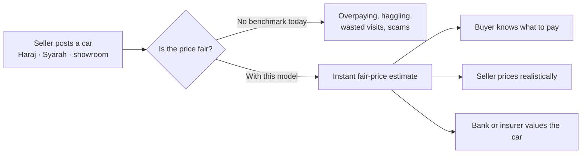
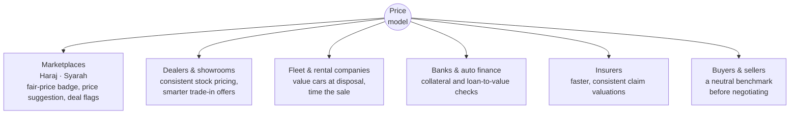
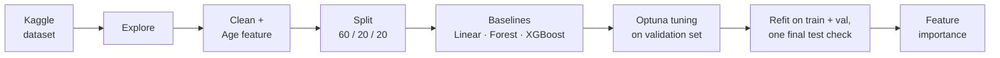
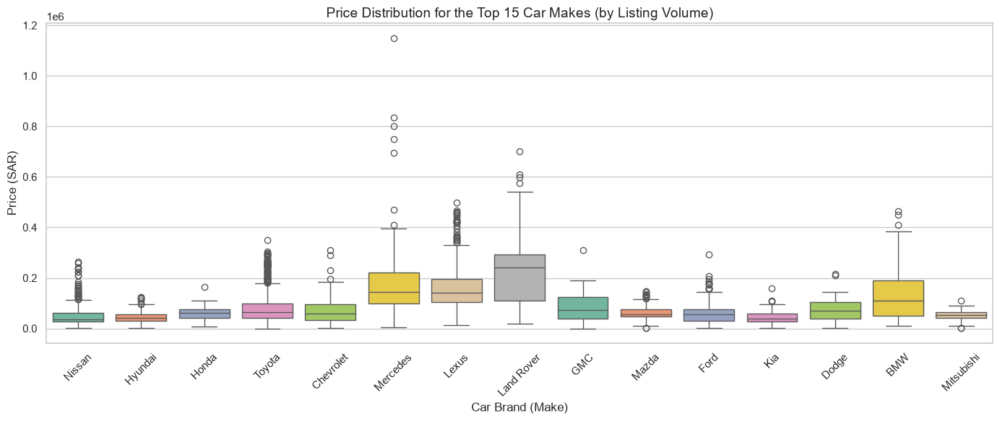
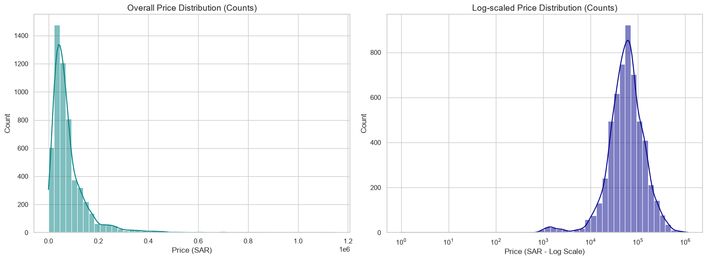
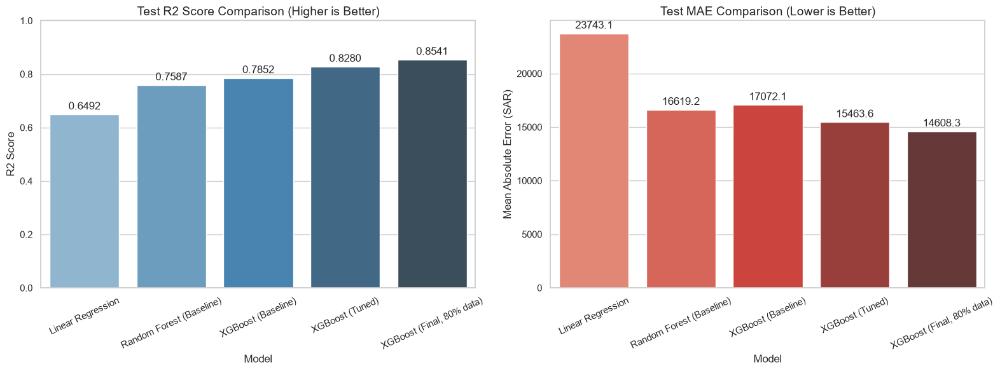
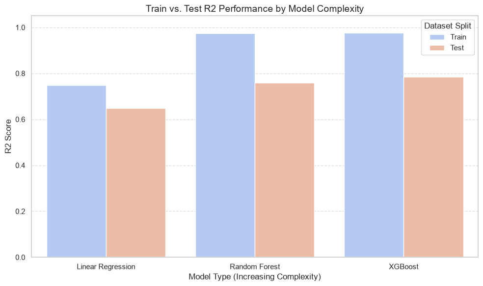
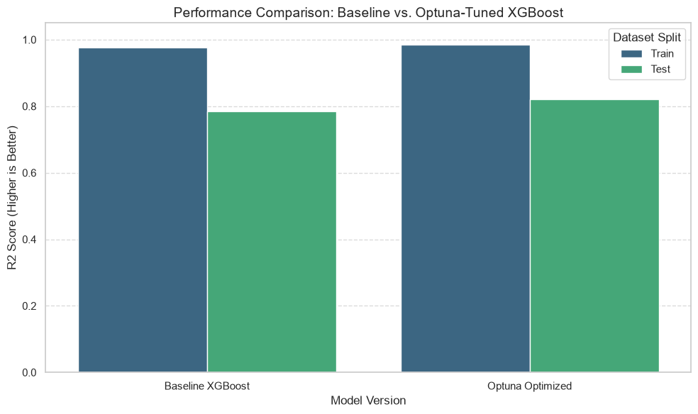
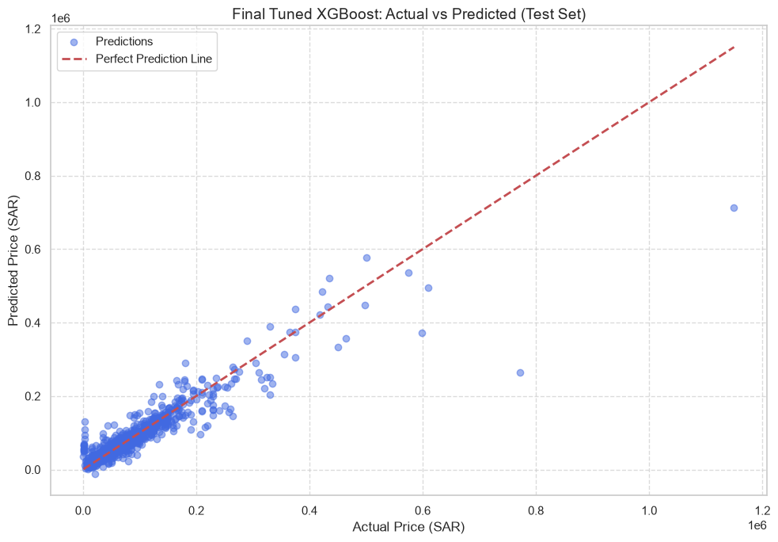
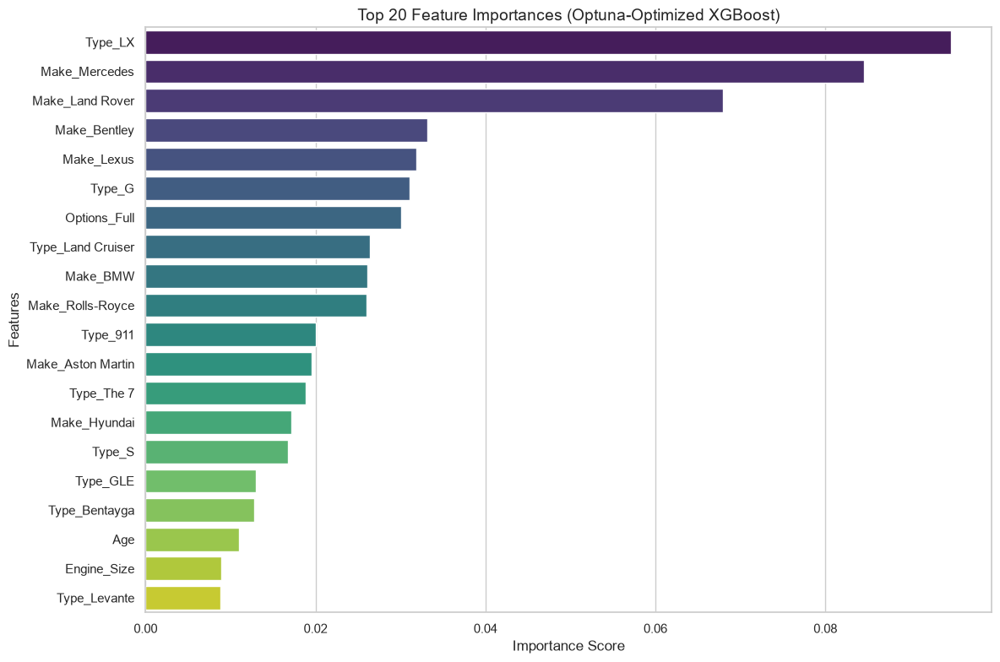

<div align="center">

# Saudi Arabia Used Car Price Prediction

**Predict the fair asking price (SAR) of a used car in the Kingdom with XGBoost and Optuna.**

[](https://colab.research.google.com/github/almanea00/saudi-used-car-price-prediction/blob/main/saudi_used_car_price_prediction.ipynb)


[](https://github.com/almanea00/saudi-used-car-price-prediction/stargazers)
[](https://github.com/almanea00/saudi-used-car-price-prediction/forks)


[**The Problem**](#the-problem) · [**Business Value**](#why-this-matters-for-saudi-businesses) · [**Method**](#how-it-works) · [**Results**](#results) · [**Next Steps**](#next-steps) · [**Run It**](#run-it)

</div>

---

## The Problem

Used cars are a big consumer market in Saudi Arabia, and a large part of it runs through classifieds such as **Haraj**, dealer showrooms, and newer marketplaces such as **Syarah**. On these channels the price is whatever the seller types in, and nobody has a neutral benchmark.



| Problem | Who it hurts |
|---|---|
| **No reference price.** Two near-identical cars can be listed thousands of riyals apart, and the buyer cannot tell which is fair. | Buyers overpay, honest sellers get undercut |
| **"Negotiable" / "call me" pricing.** Many Haraj-style ads hide the price, so the real value only shows up after calls and visits. | Buyers lose time, sellers get lowballed |
| **Information gap.** The seller knows the car's history, the buyer does not. | First-time buyers, exposed to bad deals and scams |
| **Gut-feeling dealer pricing.** Showrooms price on experience, so margins and stock turnover are unpredictable. | Dealers, fleet owners |
| **Manual valuation.** Banks, leasing companies and insurers often rely on hand appraisals. | Lenders, insurers, claims teams |

## Why This Matters for Saudi Businesses

A data-driven estimate gives every party a **fair-value benchmark in seconds**.



It also fits the direction of **Vision 2030**: digital transformation, more transparent consumer markets and data-driven decisions in everyday commerce.

## How It Works



- **Data:** [Saudi Arabia Used Cars Dataset](https://www.kaggle.com/datasets/turkibintalib/saudi-arabia-used-cars-dataset) on Kaggle (cleaned English version). The notebook downloads it automatically, so no data is stored in this repo.
- **Target:** the asking `Price` in SAR. Listings marked *Negotiable* have no usable price and are left out.
- **Feature engineering:** `Year` becomes `Age`, so depreciation is easier for models to learn.
- **No leakage:** tuning uses only the validation set. The test set is touched once, at the end.
- **Regularized XGBoost:** the search includes `min_child_weight`, `gamma` and L1/L2 penalties, to help limit overfitting.
- **Final model:** the best settings are refit on train + validation (80% of the data) before the single test-set check. Tuning alone reaches about 0.83 test R², and the extra data brings it to about 0.85.

### What the data looks like

<p align="center">
  
</p>

*Brand matters a lot: Land Rover, Mercedes, BMW and Lexus sit far above everyday brands, and luxury models have the widest price spread.*

<p align="center">
  
</p>

*Most cars are cheap and a few are very expensive, so prices are heavily skewed. The log scale on the right makes the shape easier to read.*

## Results

### Each step improves on the last

<p align="center">
  
</p>

*Left: higher R² is better. Right: lower error is better. The last bar, the final tuned XGBoost (retrained on 80% of the data), is the best on both.*

### Tuning the model

<p align="center">
  
</p>

*Out of the box, Random Forest and XGBoost score higher on the training data (blue) than on unseen cars (orange). That is why the final model is tuned on a separate validation set.*

<p align="center">
  
</p>

*Tuning lifts the score on unseen cars (green) above the baseline.*

### How close are the predictions?

<p align="center">
  
</p>

*Each dot is a car from the unseen test set. The closer to the red line, the better the prediction. The model is accurate for most cars and loses precision on the rare, very expensive ones.*

### What drives the price?

<p align="center">
  
</p>

*Luxury and exotic names (LX, G-Class, Mercedes, Bentley, Rolls-Royce, Land Rover, Porsche 911, Aston Martin) and a "Full" options level dominate. The Saudi market prices heavily on brand and trim, which matches how people actually shop.*

## Next Steps

This is a strong first version, and there is a clear path to make it better:

- **Real sale prices.** Train on final sale prices, not only asking prices, to get closer to true market value.
- **Include negotiable listings.** Model them separately so the full market is covered.
- **Add listing dates.** This would let the model follow price trends over time.
- **Add condition data.** Accident history, service records and body condition matter to real buyers.
- **Fairer accuracy for cheap cars.** Predicting `log(Price)` would give a more even error across price ranges.
- **Tighter generalization.** Cross-validation and stronger regularization to narrow the gap between training and test scores, plus CatBoost and LightGBM for comparison.
- **Explainability and deployment.** SHAP explanations, and a small web app or API a marketplace could call.

## Run It

### In Google Colab (easiest)

[](https://colab.research.google.com/github/almanea00/saudi-used-car-price-prediction/blob/main/saudi_used_car_price_prediction.ipynb)

### Locally

```bash
git clone https://github.com/almanea00/saudi-used-car-price-prediction.git
cd saudi-used-car-price-prediction
pip install -r requirements.txt
jupyter notebook saudi_used_car_price_prediction.ipynb
```

`kagglehub` may ask you to log in to Kaggle the first time it downloads the dataset.

## Acknowledgements

Dataset by [turkibintalib](https://www.kaggle.com/datasets/turkibintalib/saudi-arabia-used-cars-dataset) on Kaggle. Built as a course project.
